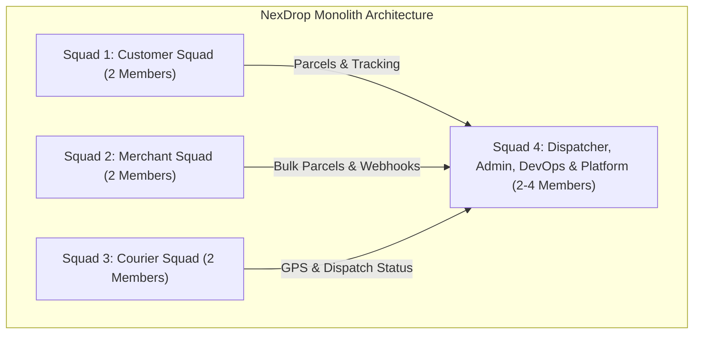

# NexDrop — Team Work Breakdown & Ownership Matrix

This document outlines the operational structure and file ownership for our group engineering team. It maps each sub-team (squad) to specific frontend directories, backend modules, database models, and Git feature branches to avoid merge conflicts.

---

## Squad Structure & Ownership



---

### Squad 1: Customer Portal & Experience (2 Members)
- **Primary Focus:** Individual sender experience, parcel booking, real-time public parcel tracking, and customer address management.
- **Frontend Ownership:**
  - `frontend/src/features/customers/`
  - `frontend/src/features/parcels/` (Customer-facing views & tracking pages)
  - Customer profile, recipient address book, tracking search bar.
- **Backend Ownership:**
  - `backend/app/modules/customers/` (`models.py`, `schemas.py`, `repository.py`, `service.py`, `routes.py`)
  - `backend/app/modules/parcels/` (Parcel creation, `GET /api/v1/parcels/track/{tracking_number}`)
- **Recommended Branch Naming:** `feat/customer-<feature-name>`

---

### Squad 2: Merchant Solutions & Integration (2 Members)
- **Primary Focus:** Business / e-commerce merchant portal, bulk parcel dispatch, automated API key issuance, and webhook event notifications.
- **Frontend Ownership:**
  - `frontend/src/features/merchants/`
  - Merchant dashboard, bulk parcel CSV upload UI, webhook endpoint configuration, API key generation UI.
- **Backend Ownership:**
  - `backend/app/modules/merchants/` (`models.py`, `schemas.py`, `repository.py`, `service.py`, `routes.py`)
  - `backend/app/modules/webhooks/` (`models.py`, `schemas.py`, `repository.py`, `service.py`, `routes.py`)
- **Recommended Branch Naming:** `feat/merchant-<feature-name>`

---

### Squad 3: Courier & Fleet Logistics (2 Members)
- **Primary Focus:** Courier app/portal, vehicle setup, shift availability toggle, real-time GPS location streaming, and delivery acceptance.
- **Frontend Ownership:**
  - `frontend/src/features/couriers/`
  - Courier mobile-responsive view, active delivery route map, shift start/end controls, delivery completion checklist.
- **Backend Ownership:**
  - `backend/app/modules/couriers/` (`models.py`, `schemas.py`, `repository.py`, `service.py`, `routes.py`)
  - Courier telemetry (`PATCH /api/v1/couriers/{id}/location`)
  - Real-time WebSocket connection handling for courier tracking channels (`/ws/{channel_id}`)
- **Recommended Branch Naming:** `feat/courier-<feature-name>`

---

### Squad 4: Dispatcher, Admin, DevOps & Platform (2-4 Members)
- **Primary Focus:** Central dispatch routing engine, dynamic pricing algorithm, user authentication/roles, CI/CD, Docker, and infrastructure.
- **Frontend Ownership:**
  - `frontend/src/features/dispatch/` (Dispatcher console & parcel assignment board)
  - `frontend/src/features/auth/` (Login, registration, role guards)
  - Admin controls (pricing tier settings, fleet monitoring, user management)
  - Shared design system (`frontend/src/components/ui/`, `frontend/src/components/shared/`)
- **Backend Ownership:**
  - `backend/app/modules/dispatch/` (Parcel-to-courier assignment logic)
  - `backend/app/modules/pricing/` (Dynamic distance/weight fare calculation)
  - `backend/app/modules/auth/` & `backend/app/modules/users/` (JWT, Argon2 hashing, role middleware)
  - `backend/app/modules/notifications/` (Notification routing to SMS, Email, In-App)
  - `backend/app/integrations/rabbitmq/` & `backend/app/core/`
  - Database migrations gatekeeper (`backend/migrations/`)
  - DevOps: `docker-compose.yml`, Dockerfiles, CI/CD pipeline, Neon PostgreSQL setup
- **Recommended Branch Naming:** `feat/platform-<feature-name>`, `feat/dispatch-<feature-name>`

---

## 2. Git Collaboration & Conflict Prevention Rules

To ensure 8–10 developers can work smoothly inside the single repository:

1. **Isolation by Feature Folder:**
   - Members should only modify files inside their assigned feature module (e.g., `app/modules/customers/`).
   - If changes are needed in shared core files (`app/main.py`, `app/api/v1/api.py`, `app/db/session.py`), coordinate with **Squad 4 (Platform)**.

2. **Database Migration Protocol:**
   - **Do not create conflicting Alembic migrations.**
   - When adding fields to your models in `models.py`, notify Squad 4 or test migration locally:
     ```bash
     alembic revision --autogenerate -m "add_<squad>_<feature>"
     ```
   - Squash/merge migrations onto `main` with approval from Squad 4.

3. **PR (Pull Request) Process:**
   - Each squad creates branches from `main`.
   - Never commit directly to `main`.
   - Before opening a PR, ensure tests pass:
     ```bash
     # Backend
     backend/venv/Scripts/pytest backend/tests -v
     # Frontend
     npm test (inside frontend/)
     ```
