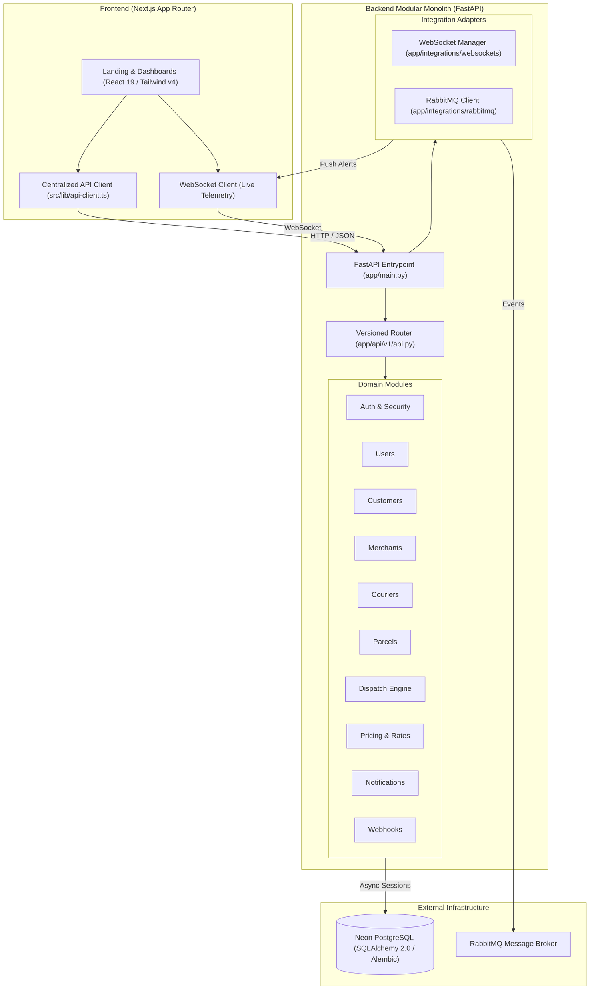
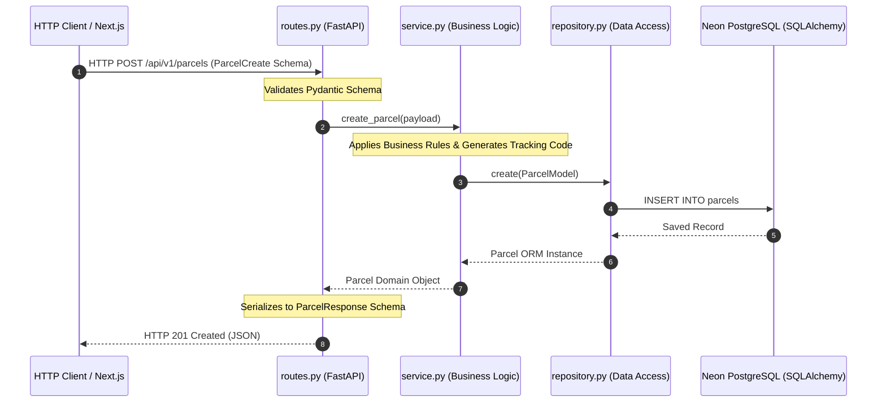
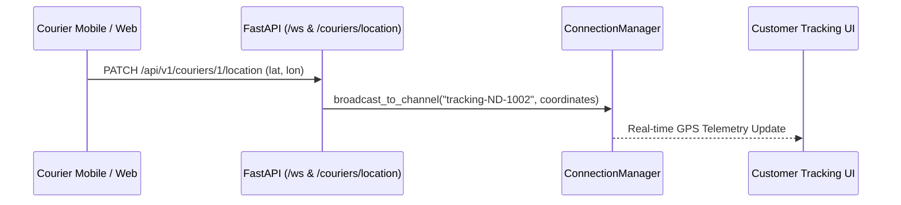

# NexDrop System Architecture Diagrams

## 1. Modular Monolith Architecture

The following diagram illustrates the single-backend modular monolith architecture and its integration points.

---

## 2. Module Internal Layering (Clean Architecture)

Each domain module in `app/modules/<module_name>` enforces this strict separation:

---

## 3. Real-Time Tracking Flow

